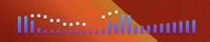
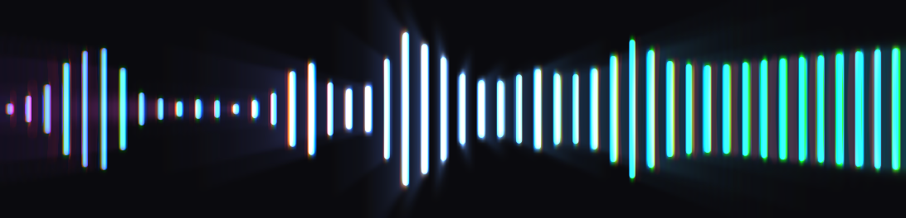
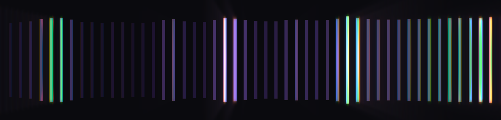
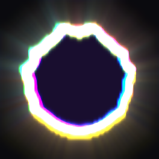
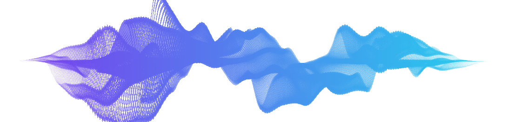
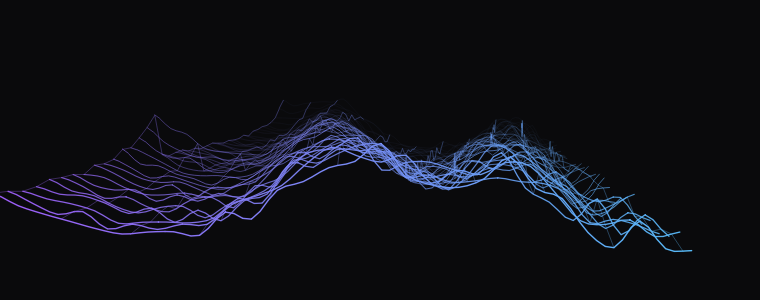
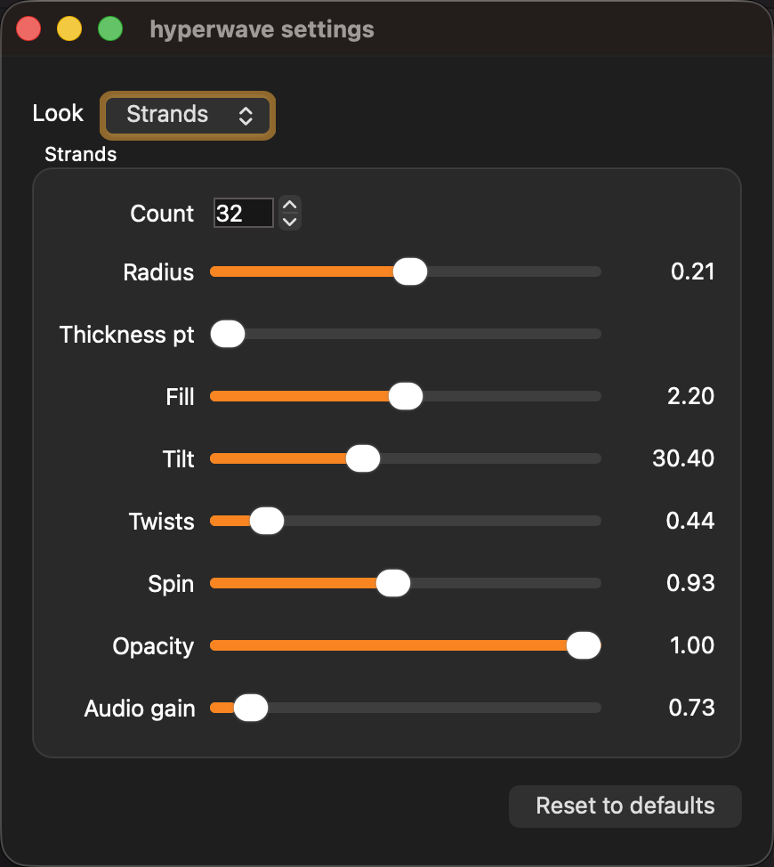
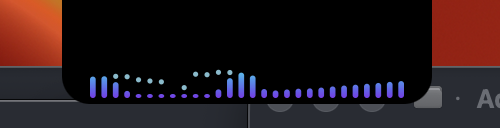
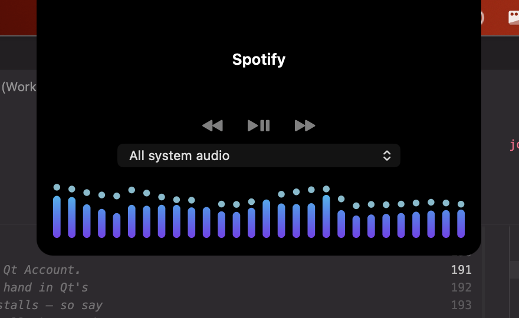

# hyperwave

A system audio visualiser that lives in the menu bar. It does one job.



Twenty-eight bars, a violet-to-cyan gradient anchored to the strip rather than
to each bar, peak-hold dots that fall under gravity, and a fade to a resting row
of dots when nothing is playing. Roughly 91 x 22 points of menu bar.

The bars sit a point apart, which is as tight as they go while staying crisp:
they are positioned at `insetLeft + k * (width + gap)` and scaled by the device
pixel ratio at paint time, so a 3pt stride is 3px at 1x, 6px at 2x and 9px at
3x -- whole pixels everywhere. Half a point would be a half pixel on a
non-Retina display, which looks fine on a laptop and blurry on someone's
external monitor.

## Six looks, and one thing that happens to all of them

Switch in `Appearance`, or `--viz <name>` for one run.

**Bars** is the default and what the screenshot above shows.

**Mirror** is the same bars, thinner and grown from the centre line in both
directions, so the eye reads the envelope rather than the tops. Movement runs
through an underdamped spring rather than an eased interpolation: it overshoots
slightly and settles back, and that small bounce is most of the character. An
eased value cannot do it, because easing has no velocity to overshoot with.



**Lines** is a wall of upright strokes, each lit by one band, flashing rather
than pulsing. The renderer is the plainest in the project -- it draws
rectangles -- because everything that makes it worth looking at happens
afterwards, in the glow.



**Ring** is a closed outline pushed outward by the spectrum, drawn five times in
separated colours over a dark disc. Two details do the work. The outline is
mirrored, so the spectrum runs out along one half and back along the other and
the shape stays symmetric however the music moves. And the copies are offset two
ways at once -- by amplitude, which scales with how far the ring has been pushed
out, so the fringes land on the protrusions; and by a constant, which shifts them
everywhere, so they read as layers out of register rather than as a glow. Cyan,
magenta and yellow, because overlapping CMY darkens towards the middle the way a
four-colour process does, where RGB would just make a rainbow.



**Strands** is a bundle of lines wrapped around an axis: each is the same
straight line, displaced radially by a radius that the spectrum and three
octaves of simplex noise push around, twisting like a finger trap and tapered
to points at both ends. X is frequency, so the tube swells where the music is.
A port of Matt DesLauriers' codevember #21 (MIT, credited in
[THIRD-PARTY-NOTICES.md](THIRD-PARTY-NOTICES.md)).



It runs on the GPU through QRhi -- Metal on macOS -- because that is what the
technique *is* rather than because a GPU was available. The geometry is static,
uploaded once and never touched; every frame's motion is a vertex shader, and
the CPU's whole job is a 256-byte spectrum texture and a clock. The strand count
is very nearly free: 32 strands and 1024 strands measure within noise of each
other, because the entire CPU cost is the fixed offscreen round trip and the GPU
absorbs 204,800 vertices without noticing.

**Terrain** is the same analysis with a memory. Each time slice becomes a
polyline across the frequency bands, and the slices stack away from you under
perspective -- frequency across, level up, time receding -- so what you watch is
a ridge of mountains sliding backwards as it ages.



It is projected in software rather than on the GPU, which deserves a defence
because "3D" usually implies otherwise. At status item and notch panel sizes the
whole terrain is forty polylines of about eighty points, which QPainter draws in
1.0 ms; a GPU path would need a context, a framebuffer and a readback per
surface to reach the QImage every presenter here requires. The honest cost is
not the wall-clock one, though: Qt's raster engine spreads stroking across its
thread pool, so summed CPU is roughly triple what a stopwatch around `render()`
suggests.

## Settings

**`Settings...`** in the menu opens a window with every parameter of whichever
look is running, each taking effect on the next frame and saved as it changes.
"Reset to defaults" clears the stored values rather than writing the current
ones back, so a later change to a default is picked up rather than frozen at
whatever shipped.



It is the same widget the debug HUD embeds. Keeping it one widget is what stops
a parameter existing for development and being unreachable by anyone outside
this repository.

**Colour** is a separate choice from the look, in `Appearance`, or `--gradient
<id>` for one run. Four fixed ramps -- `signature` (violet to cyan, the
default), `ember`, `lagoon` and `rainbow` -- plus `mono`, which takes the menu
bar's own foreground colour so it follows light and dark and never fights the
wallpaper.

`rainbow` is the one that is not simply a pair of colours, and each look maps it
to whichever axis it has. The bar-shaped ones run it left to right, so a bar
keeps its hue instead of changing colour as it moves. **Terrain and strands run
it along depth**: the nearest ridge, and the near surface of the tube, are the
start of the ramp, and it recedes through the spectrum away from you. The ring
is left alone deliberately -- that look's identity is already colour
separation, five offset copies in cyan, magenta and yellow, and a hue ramp
through them reads as confetti rather than as a mis-registered print.

The ramp stops at violet rather than closing the hue wheel back to red. A closed
wheel has no visible beginning or end, which is exactly the information the depth
looks are using it to carry.

## Glow


The lines, which are the look glow exists for.

It is set **per look, not once for the app**, and the lines and the ring are the
two that arrive with it on. That is less a preference than part of what a look
is: both draw something that emits rather than something that reflects, while
the bars are objects with edges and haloing them turns a legible meter into a
smear. A single switch for all six meant choosing which half to spoil.

The bright pass and the blurs run downscaled, but only where there is resolution
to spare. The ring asks for a square status item -- 44 pixels across at 2x -- and
a quarter of that is an eleven-pixel bloom texture, which composited back over
the original does not read as glow so much as being out of focus. The divisor
backs off on small targets.

Bloom is not a property of any look. Deciding which pixels are lit and deciding
what light does to them afterwards are different questions, so it is four
full-screen passes applied to whatever a visualiser drew: keep what is bright
enough to glow, blur it horizontally, blur it vertically, composite it back with
the red and blue channels pulled apart along the radius. Every look gets it on
the same terms, including looks that do not exist yet.

The dispersion is the part worth explaining, because it is what the reference
image is actually made of. A real lens focuses red, green and blue at slightly
different places, and the error grows with distance from the optical axis — so
centre lines stay sharp and white while edge lines split into warm and cool
fringes and smear outwards. Sampling each channel at its own radial offset,
scaled by the square of the radius, reproduces that with no special case for the
middle.

One thing had to be learned by looking at it: the **core** must keep its
registration and only the **glow** may disperse. Splitting the source itself was
the first attempt, and a one-pixel line shifted several pixels per channel stops
overlapping itself — red, green and blue land on empty background and one line
renders as three coloured ones, most visibly a pure green one where only the
unshifted channel hit.

It runs on the GPU through QRhi, sharing one Metal device with the strands
renderer, and costs about four points of a core at status item size: bars
measure 11.1% without it and 14.8% with, which buys a bright pass, two blurs, a
composite, an upload and a readback every frame.

## What makes this one different

**No virtual audio driver.** macOS 14.2 shipped CoreAudio process taps, and
hyperwave uses one: `CATapDescription` with an empty exclusion list gives a
global mix of everything the system is playing. There is no BlackHole to
install, no output device to switch to, and no Screen Recording permission to
grant — just a single "System Audio Recording" grant, and the audio path is
untouched.

## The notch panel

On a notched Mac the status item is not reliable. Measured on a 1728pt built-in
display with an editor's nine menus on the left and fourteen status items on the
right, hyperwave's strip gets pushed underneath the camera housing and becomes
invisible — while macOS still reports `statusItem.visible == true`. The app is
running, the tap is working, and you see nothing.

So on those Macs hyperwave draws a panel anchored to the housing instead. The
space directly below the notch is the one part of that region no other app
competes for, which is what makes it a fix rather than another contender.

**One or the other, never both.** On a Mac with a housing the panel is the
default, because it is the surface that cannot be crowded out. Uncheck
*Appearance → Draw in the notch* and the strip moves back to the menu bar as an
ordinary status item; the choice is remembered, and it applies the moment you
pick it. On a display with no housing there is no choice to make and the status
item is all there is — including when you close the lid on a docked MacBook,
which takes the housing away mid-session and hands the strip back to the bar.

Asking for the menu bar on a notched Mac does not always get it. macOS lays
status items out right-to-left and steps straight over the housing, so on a
crowded bar the slot hyperwave is given can fall underneath it — where there
are no pixels and nothing to click, while `NSStatusItem.visible` still reports
`YES`. hyperwave measures the item against the housing after installing it and
goes back to the panel if they overlap, because the alternative is a running app
with no surface anyone can reach and no menu to fix it from. The menu entry then
reads *menu bar is full*; choose it again once you have made room and it retries.
If you ever do get stuck with nothing on screen,
`defaults write com.hypernuclear.hyperwave "notch.usePanel" -bool true` and
relaunch.



Collapsed, it is a tab hanging below the housing with the strip inside it. The
notch is 185pt wide, so the panel shows all 28 bands even when the menu bar is
too crowded for more than 14.



Hover and it eases down into a taller panel: bigger bars, more room. The
screenshot is the panel alone -- on a notched Mac its top row sits behind the
camera housing itself.

There is deliberately nothing in it but the strip. It used to carry a dropdown
for the audio source, which was a second copy of a list the right-click menu
already has and cost the panel a row it did not need.

**Right-click the panel for the menu.** That is not a convenience; it is the
only way in on the display this panel exists for. If the status item has been
crowded under the notch, "click the status item" is not an available answer.

By default the tab retracts when nothing is playing, so the notch looks stock on
a quiet machine. The window stays alive at exactly the housing's size — a
physical cutout, so nothing shows — which keeps the notch hoverable. Hovering a
retracted panel still opens it, so there is always a route to the menu even when
the status item is invisible and nothing is making noise.

## Choosing a source

The source list is **output devices**, not applications.

Applications were the wrong axis twice over. CoreAudio will tell you whether a
process holds an open output stream — `kAudioProcessPropertyIsRunningOutput` —
but not whether it is actually making a sound, and there is no property that
does. Measured on an idle machine, a 3D editor and a paused music player both
reported "playing" with the room silent. And a Mac with a virtual device, an
audio interface and three monitors has a genuinely interesting choice of *where*
sound is going, which an app list cannot express at all.

So: `Source ▸` in the menu, and a dropdown in the notch panel, both listing
every device with output channels and marking the current one. Picking one taps
`CATapDescription initExcludingProcesses:andDeviceUID:withStream:` — still a
whole-system mix, restricted to one destination. Verified by tapping the
built-in speakers while audio was routed to a virtual device: the tap stayed
alive at 463 callbacks and reported −120 dB, against −14.2 dB for the device
actually in use.

## Hearing the room

`Include microphone input` mixes an input device into the analysis alongside the
system output, so the visualiser answers "what can this machine hear" as well as
"what is it playing". On by default, which means a first run asks for the
microphone; the menu item turns it off and the choice persists.

It could not reuse the tap. A CoreAudio process tap answers what the machine is
*playing*; there is no variant of it that answers what the machine can *hear*.
So this is a second IO proc on the default input device, on its own clock,
writing to its own ring — two producers on one single-producer ring is not a
ring — and the DSP sums the two over as much of each block as both have.

Two honest limits. The analysis is configured from the *output* rate, so an
interface running its input at a different rate lands the mixed-in signal off
pitch; both are usually the same and it does not arise, which is why the input
rate is logged rather than assumed. And a denied microphone grant produces a
running IO proc delivering silence, exactly as a denied audio-capture grant
does, so nothing here treats silence as evidence of either.

## What is playing

`Playing ▸` lists the applications actually making a sound, loudest first, with
their icons. Informational and deliberately not selectable: which apps have
audio going is a different question from where the visualiser listens.

The list is built from a **measurement**, not from
`kAudioProcessPropertyIsRunningOutput`, and it is grouped by application rather
than by process. Both halves were necessary and each was learned the hard way.
That property is wrong in both directions: a 3D editor holds a stream open for
hours while emitting digital silence, and a browser plays through a helper that
never claims one at all. It is not consulted here any more, not even to order
candidates — Apple's background machinery holds output streams open
permanently, so ranking stream-holders first handed every tap slot to
`universalaccessd` and `loginwindow` and pushed real applications off the end.
Grouping matters just as much, because the level and the identity are almost
never on the same process. Measured with a YouTube tab playing: a tap on the
*unnamed* `com.google.Chrome.helper` read **−17.0 dB**, taps on
`com.google.Chrome` and on the named "Google Chrome Helper" both read −120, and
a global tap minus Spotify read −16.9 — the same signal. Chrome's audio was
fully attributable the whole time, just not to a process anyone would
recognise. So every process an application owns is metered, the loudest wins,
and the name and icon come from whichever process has them.
Some applications have no named process at all — Electron apps like Cursor
register three helpers and never themselves — so the name is resolved from the
bundle id through LaunchServices. Anything that resolves to nothing is
anonymous by nature, cannot appear in a menu, and is metered last if at all:
`systemsoundserverd`, WebKit's shared GPU service, the Core Audio driver host.
That last one is worth naming, because it is the loudest decoy on the machine —
when a virtual output device is in use it re-renders the entire system mix at
about −41 dB and looks, to a naive meter, like the answer.
The measurement is cheap because one private aggregate device can hold *several*
taps at once: `kAudioAggregateDeviceTapListKey` takes an array, and each tap
arrives as its own buffer in a single IOProc. So metering N applications costs
one aggregate, one IO thread, and an RMS per buffer — not N of everything. With
music playing and an editor idle, the editor's own tap reads −120 dB while the
player's reads −5.9 dB, which is not a close call.

The level decays over about two seconds rather than tracking the signal, so a
gap between tracks does not make an app blink out of the list.
Verified end to end, with `HYPERWAVE_METER_DEBUG=1`: silent machine with a 3D
editor and a paused player running, nothing listed; YouTube playing in Chrome,
`Google Chrome −21.3 dB`; tab stopped, the level decaying away through −33 and
−42 to nothing.

## What it sends

Usage analytics, on by default, switched off in the menu under **Send Anonymous
Usage Data**. Off is the real thing: the SDK is never initialised, no device id
is computed, and no request is made. A build with no app key compiled in -- which
is every local build, including yours -- has no backend at all and hides the
menu entry rather than showing a switch that does nothing.

What goes out is which look and colour are running, whether the microphone is
mixed in, whether a specific output device was chosen rather than the whole
system mix, the platform, and the app version.

What does not, and cannot: **anything the app hears**. No audio, no spectrum, no
track titles, no application names from the `Playing` list, no output device
names. This is worth stating plainly because hyperwave is in an unusual position
to leak it -- it can hear everything the machine plays, and everything the
microphone hears when that is turned on. The interface takes a name and a small
map of values, every call site passes constants or a bounded string like `ridge`
or `rainbow`, and the rule in `src/analytics/Analytics.h` is that an event
needing a value from the audio system is an event that does not get added.

The install is identified by a SHA-256 of the machine's hardware id. The hash is
one-way, the raw id never leaves the machine, and it is computed the same way in
the sibling products -- so the same machine reports the same id to each of them,
which is a correlation worth knowing about and a reason the switch exists.

## Permission

The system-audio grant is **required and silently enforced**. Without it
`AudioHardwareCreateProcessTap` still succeeds, the IOProc still fires, and
every sample is zero. Verified by running the same signed binary at the same
moment under two bundle ids: the granted one read −14.2 dB, the ungranted one
−120 dB with the tap alive at 39 callbacks. macOS did not prompt.

Two things follow.

**"System Audio Access…" is always in the menu**, never conditional. It used to
appear only when the app had concluded it was being denied — worse than useless,
because the conclusion was unreliable and because macOS may never prompt on its
own. Silence is now treated as silence; the only hard evidence of denial is the
tap creation failing outright.

**Running from a terminal masks all of this.** TCC attributes a capture request
to the *responsible* process, and a binary exec'd from a shell inherits the
terminal's grant rather than using its own. So running the executable directly
works even with no grant of its own — and hyperwave will not appear in System
Settings, because the permission in play belongs to the terminal. To exercise
the real path, launch through LaunchServices:

```sh
open build/hyperwave.app
```

## Requirements

- macOS 14.2 or later (process taps landed in 14.2)
- Qt 6.11+ — the online installer, at `~/Qt/6.11.x/macos`

**Windows works.** WASAPI loopback capture, a docked application desktop toolbar
and a tray icon, built and packaged by CI and exercised on a real machine. It is
newer than the macOS side and has had far less use, so treat rough edges as
likely rather than surprising. Linux is still stubs.
[docs/windows-backend.md](docs/windows-backend.md) has the decisions, the build
order and the traps.

## Build

```sh
cmake --preset dev
cmake --build --preset dev
open build/hyperwave.app
```

Qt is found automatically: `QT_ROOT` if set, otherwise the newest
`~/Qt/6.*/macos`. Override with `-DCMAKE_PREFIX_PATH=...`, or keep a local
`CMakeUserPresets.json` (git-ignored) with a preset inheriting `dev`.

Every build is code-signed with the hypernuclear Developer ID. That is not about
distribution — an ad-hoc signature is keyed by the code hash, so each rebuild
would look like a brand new app and re-prompt for the audio permission forever.

```sh
ctest --preset dev
```

### In CI

`.github/workflows/ci.yml` builds and tests both macOS architectures on every
push and pull request, and it does **not** assume a Qt is present: it fetches
the open-source binaries from download.qt.io with
[`install-qt-action`](https://github.com/jurplel/install-qt-action) and
aqtinstall, pinned to the same 6.11.2 the local build wants. So a red CI run
means the tree is broken rather than the environment being different.

Two wrinkles are baked in rather than left to be rediscovered. `qtsvg` is
deliberately *not* in the module list — in Qt 6 it is part of the base install,
and naming it fails with an error that reads as though it were missing.
aqtinstall is pinned to a commit rather than the PyPI release, because 3.3.0
cannot parse Qt 6.11's repository layout, so the action is pinned to a commit
that can.

The suite is headless, so it runs on a runner with no audio device and no
display. It cannot cover capture, the status item or the notch panel — those
need a real machine and a granted permission — and CI does not pretend
otherwise.

### In VS Code

`.vscode/` is committed and carries no machine-specific paths. F5 gives you the
menu bar item; the drop-down also has windowed mode for renderer work, a HUD
configuration, a faked notch for developing the panel in clamshell, a
capture-only run, and one entry per test binary for stepping into a failure.
**"Preview (live controls)"** is the one for looking at a visualiser properly.
It opens the window with the controls attached: which look, how much to
magnify, and every parameter of the strands and the terrain -- count, radius,
thickness, fill, tilt, twists, spin, opacity, gain; rows, subdivision, columns,
depth, amplitude -- each taking effect on the next frame. A synthetic-audio
variant needs nothing playing and no capture permission, so it behaves the same
on any machine.
Magnification is applied as device pixel ratio rather than by stretching a
bitmap, so thickness, insets and bar widths scale in proportion and what you
see is what the renderer would draw at that size.
Tuning lives in the window rather than on the command line on purpose. These
are parameters decided by looking at them, and a flag per parameter means one
process per combination.

One wrinkle worth knowing before it costs you an afternoon: a debugger launches
hyperwave as a child of VS Code, so **TCC uses VS Code's system-audio grant,
not hyperwave's**. If VS Code has not been granted "System Audio Recording",
the tap is created, the IOProc fires, and every sample is zero — the app looks
alive and the bars stay flat. There is a "Run as a real app (LaunchServices)"
task for checking the other side of that.

## Flags and env

| | |
|---|---|
| `--verify-audio` | Print capture levels for five seconds and exit. The fastest answer to "can it hear the system?" |
| `--windowed` | Render into a window instead of the menu bar, for iterating on the visuals |
| `--hud` | Diagnostics window: OSStatus, callback count, RMS, AGC, sample rate, overruns |
| `--shot <path>` | Render one settled frame to a PNG and exit |
| `--source <uid>` | Listen to one output device by UID. `--source list` prints them |
| `--gradient <id>` | Which colour ramp: `signature`, `ember`, `lagoon`, `rainbow` or `mono`. Overrides the saved preference for one run, without rewriting it, which is what makes `--shot` usable for comparing them |
| `--viz <style>` | Which visualiser to draw: `bars` (default), `mirror`, `lines`, `ring`, `strands` or `ridge`. Overrides the saved preference for one run |
| `--preview-scale <n>` | Magnify the windowed and `--shot` canvas, for looking at a visualiser at a size where its detail is visible. Applied as device pixel ratio, so every measurement scales with it |
| `HYPERWAVE_STRANDS=n` | How many strands in the bundle. Very nearly free: 32 and 1024 measure the same |
| `--fake-notch` | Pretend the display has a notch, for developing the panel on an external monitor |
| `HYPERWAVE_FAKE_AUDIO=1` | Drive the DSP from a synthetic sweep, so the renderer can be worked on with no audio and no permission |
| `HYPERWAVE_METER_DEBUG=1` | Log the metered applications in priority order, any that ran out of tap slots, and the "Playing" list itself every two seconds. Every wrong answer this list has given was found by a human opening a menu and disagreeing with it; this makes the same question answerable in one command |

## Layout

```
src/
  dsp/        FFT, band mapping, ballistics, config     -- no platform code
  audio/      lock-free ring, downmix, source interface -- no platform code
  render/     the one renderer, QPainter -> QImage      -- no platform code
  platform/   CoreAudio tap, NSStatusItem, notch panel; WASAPI + appbar; Linux stubs
  app/        wiring: controller, DSP thread, settings, menu model, HUD
tests/        headless, links only the shared core
```

`dsp/`, `audio/` and `render/` contain no `#ifdef Q_OS_*` and are not permitted
to. The Windows appbar and the macOS status item are meant to show pixels from
the *same* renderer; the moment the platforms run different DSP you get to chase
"the bars look different on Windows" for a day.

`platform/` holds that seam in three interfaces: `AudioSource` for capture,
`BarPresenter` for a surface that draws a QImage and nothing else, and
`PanelPresenter` for the richer surfaces -- the notch panel, the appbar -- that
also retract when idle and can carry their own source picker. Exactly one
presenter is installed at a time; `App::reviewSurfaces()` picks it and re-picks
it whenever the displays or the preference change.

## Three things that are load-bearing

**`QSystemTrayIcon` cannot do this on macOS.** Qt's Cocoa plugin calls
`setTemplate:` on the status-item image, and a template image is a monochrome
mask — the gradient would arrive as a flat silhouette. hyperwave uses a native
`NSStatusItem` hosting a layer-backed view, and never assigns `button.image`.
`QSystemTrayIcon` is still the right answer on Windows and Linux, where nothing
flattens the icon -- but on Windows it draws a **static** mark rather than the
visualiser. At the 16-24 px the shell asks for, twenty-eight bands is eight bars
of three pixels, and `Shell_NotifyIcon` is a cross-process call into
`explorer.exe`: animating it means an IPC round trip fifteen times a second,
forever, to draw something illegible. The moving picture belongs on the appbar,
which has room for it.

**The IOProc zeroes its output buffer unconditionally.** If the tap-only
aggregate ever fails and we fall back to including the default output device as
a sub-device, hyperwave becomes an output client of the user's speakers and
whatever sits in that buffer is what they hear. The HAL does not promise to hand
it over zeroed. One `memset` per callback is the cheapest insurance in the
project.

**Silence is never treated as denial.** A tap without permission delivers
digital silence, and so does a machine with nothing playing, and CoreAudio
exposes no per-process level that could tell them apart. The original design
thought `IsRunningOutput` could; it cannot, and the resulting probe accused a
working install on any quiet desktop.

## Cost

Measured on an M-series Mac, Release build, 60 fps, one P-core:

| | |
|---|---|
| Bars | 14.8%, or 11.1% with the glow off |
| Mirror | 14.9% |
| Lines | 12.5% |
| Strands (GPU) | 14.7% |
| Ring | 21.1% |
| Terrain | ~19% |
| Nothing playing | display link stops; the strip holds its resting frame |

Every figure above includes the glow, which is about four points on its own. The
looks that draw the most geometry are not the most expensive ones: the strands
push 204,800 vertices through the GPU for less than the terrain spends stroking
a few thousand polyline points on the CPU.

About 2 points of that is the per-application metering. Forty live taps cost no
more than twenty did — measured at 9.1% against the same 9% — because the
metering IOProc itself is free (8 samples in a 4-second profile) and the HAL is
already delivering the streams. Forty is enough to cover every third-party
application on a busy machine with its helpers, which is the number that
matters: an app that loses a tap slot is invisible, and looks exactly like a
bug in the meter. Turning the source picker's `--source list` on a quiet machine
is the cheapest way to see the same information without it.

Halving the frame rate saves more than half, because most of the per-callback
cost is AppKit's display-link dispatch rather than anything hyperwave draws.
30 fps is used automatically in Low Power Mode.

## Licence

hyperwave's own source is MIT. See [LICENSE](LICENSE).

What you may do with a **binary** depends on the Qt you linked, not on this
repository. Built against open-source Qt, every module hyperwave uses today
offers LGPLv3, and the app links Qt's frameworks dynamically and unmodified.
Built against a commercial Qt licence, no such obligation arises.

One thing to know before it costs you: **Qt Quick 3D is GPLv3-only** — verified
from its own headers, `LicenseRef-Qt-Commercial OR GPL-3.0-only`, with no LGPL
option where every other module has one. It is not linked today, and linking it
would make an open-source-Qt binary GPLv3. That is a one-line change to make by
accident, which is why it is written down.

Details, and the rest of what a build pulls in, are in
[THIRD-PARTY-NOTICES.md](THIRD-PARTY-NOTICES.md).
